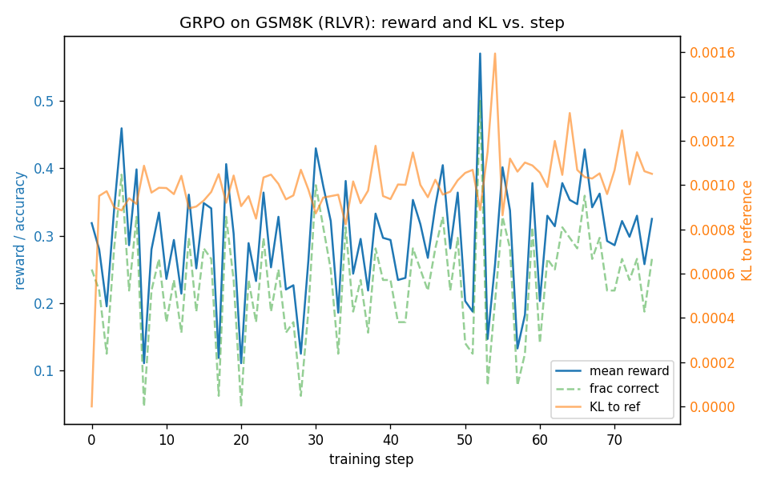

# GRPO-Zero

A **from-scratch implementation of GRPO** (Group Relative Policy Optimization) used to train a small open LLM (Qwen2.5-0.5B/1.5B-Instruct) on grade-school math (GSM8K) with a **verifiable reward** (RLVR — RL from Verifiable Rewards). The point is the update loop is implemented by hand — rollout, group-relative advantages, a PPO-style clipped objective, and a KL penalty to a frozen reference — not delegated to a library trainer. (Hugging Face TRL is used only to cross-check the math.)

**Goal:** reproduce the core finding that *RL against a verifiable reward measurably improves reasoning accuracy* — reported as a real baseline→trained pass@1 delta on the GSM8K test set.

## Why this is interesting

In RLVR there is **no learned reward model**. The reward is a deterministic program that checks whether the model's final answer is correct. GRPO then replaces PPO's value/critic network with a **group baseline**: for each prompt you sample a group of G completions, score them, and normalize the rewards *within the group* to get advantages. No critic → simpler and more memory-efficient, which is why it's the workhorse for verifiable-reward reasoning training.

## The GRPO update (what's implemented in [`src/grpo.py`](src/grpo.py))

For each prompt, sample a group of $G$ completions $\{o_1,\dots,o_G\}$ and score each with the verifier to get rewards $r_i$.

**1. Group-relative advantage** (the baseline is the group mean; no critic):

$$A_i = \frac{r_i - \mathrm{mean}(r_{1:G})}{\mathrm{std}(r_{1:G}) + \varepsilon}$$

Every token in completion $i$ gets the same advantage $A_i$. A group with identical rewards has $A_i\approx 0$ — nothing to learn from that prompt this step.

**2. PPO-style clipped policy loss**, with $\rho_t = \exp(\log\pi_\theta(o_t) - \log\pi_{\theta_\text{old}}(o_t))$:

$$\mathcal{L}^\text{pol} = -\frac{1}{G}\sum_i \frac{1}{|o_i|}\sum_t \min\big(\rho_t A_i,\ \mathrm{clip}(\rho_t, 1-\epsilon, 1+\epsilon)\,A_i\big)$$

**3. KL penalty to a frozen reference** (unbiased low-variance "k3" estimator, always $\ge 0$):

$$\mathbb{D}_\text{KL}\big[\pi_\theta \,\|\, \pi_\text{ref}\big]_t = \exp(\log\pi_\text{ref}(o_t) - \log\pi_\theta(o_t)) - (\log\pi_\text{ref}(o_t) - \log\pi_\theta(o_t)) - 1$$

**Total:** $\mathcal{L} = \mathcal{L}^\text{pol} + \beta\,\mathbb{D}_\text{KL}$, averaged per-sequence then over the batch.

Memory levers: **LoRA** policy (the frozen reference is the *same* model with the adapter disabled — no second copy), bf16, gradient checkpointing, micro-batched log-prob/grad passes, capped completion length.

## Verifier (the reward) — [`src/verifier.py`](src/verifier.py)

Deterministic, unit-tested. Extracts the final answer (number after the last `####`, else inside `\boxed{}`, else last number as a fallback), normalizes it (commas, `$`, `%`, signs, decimals, fractions), and compares to gold:

```
reward = 1.0 if correct else 0.0   +   0.1 if answer emitted in #### / \boxed{} format
```

The format bonus is independent of correctness, so it shapes output style without inflating the correctness signal.

## Results

| | model | metric | n | accuracy |
|---|---|---|---|---|
| **Baseline** (no training) | Qwen2.5-0.5B-Instruct | pass@1 (greedy) | 100 (test subset, MPS) | **0.47** |
| Baseline (full set) | Qwen2.5-0.5B-Instruct | pass@1 (greedy) | 1319 (Kaggle T4) | **0.4397** (580/1319) |
| **GRPO-trained** | + LoRA adapter, **70 of 200 planned steps** | pass@1 (greedy) | 1319 (Kaggle T4) | **0.4329** (571/1319) |

**Honest read:** on the full test set the trained adapter is 0.0068 *below* the baseline (-9 problems), i.e. no measurable improvement. Training hit a 4.5 h cap on the T4 (bf16 emulated, ~215 s/step) at 70 of 200 steps, mean reward only rose 0.300 -> 0.324, so this run is too short to confirm or refute the GRPO gain. Details, GPU/torch versions and logs: [`results/kaggle-t4-2026-10-15/`](results/kaggle-t4-2026-10-15/README.md). The 0.47 above is a 100-problem MPS subset and is not comparable to the full-set numbers.



Sample before/after (GSM8K test problem 23, gold 8): baseline answered 7 (subtracted 1 cm after mis-setting the problem), trained answered 8 via `4 h x 2 cm/h`. Problem 29 (gold 104): baseline 71, trained 104. The trained model also got 99 problems wrong that the baseline had right, so these are cherry-picked fixes, not a trend.

The full-test-set baseline and trained numbers, the reward curve, and before/after sample completions are produced by the Colab run below and filled in here with the **real measured values** — no placeholders.

## Run it

**Dev / verifier / small eval (CPU or Apple MPS):**
```bash
python -m venv .venv && .venv/bin/pip install -r requirements.txt
.venv/bin/python -m pytest -q tests/                          # 53 tests
.venv/bin/python -m src.eval --n 100 --tag baseline           # baseline pass@1
```

**Training (CUDA GPU — Colab):** open [`notebooks/colab_train.ipynb`](notebooks/colab_train.ipynb) (set Runtime → GPU). It clones the repo, runs the unit tests, the overfit sanity check, the full-set baseline, the GRPO training run, and the trained-policy eval, then plots the curves.

Everything is config-driven via [`configs/grpo_gsm8k.yaml`](configs/grpo_gsm8k.yaml); the code autodetects `cuda → mps → cpu`.

## Repo layout

```
src/verifier.py   RLVR reward: answer extraction + scoring (unit-tested)
src/data.py       GSM8K loader + Qwen2.5 chat prompt template
src/grpo.py       rollout, group advantages, per-token logprobs, clipped loss + KL, train step
src/train.py      training loop + reward/KL logging + LoRA checkpointing
src/eval.py       pass@1 / pass@k, base model or trained adapter
configs/          grpo_gsm8k.yaml
tests/            verifier + GRPO-math unit tests (model-free)
notebooks/        colab_train.ipynb (end-to-end on a GPU), analysis.ipynb (before/after + curves)
```

## References

- Shao et al., 2024 — **DeepSeekMath**: introduces GRPO. [arXiv:2402.03300](https://arxiv.org/abs/2402.03300)
- DeepSeek-AI, 2025 — **DeepSeek-R1**: RLVR for reasoning. [arXiv:2501.12948](https://arxiv.org/abs/2501.12948)
