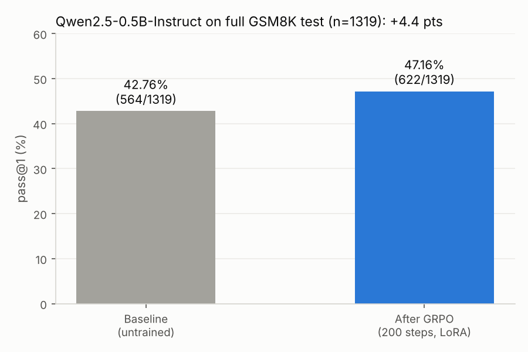
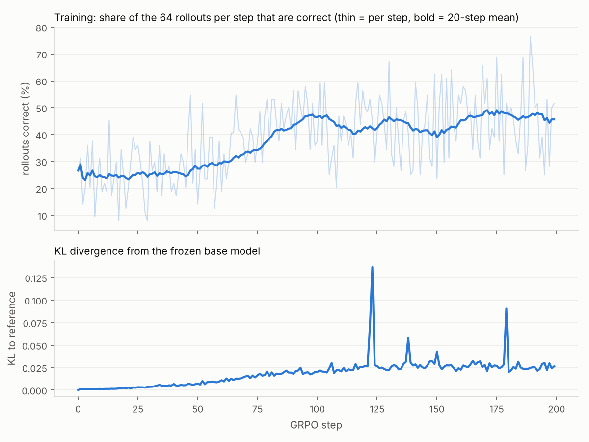
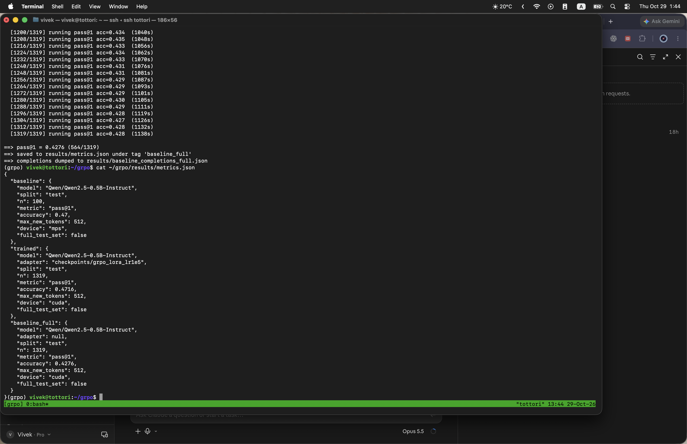

# GRPO-Zero


[](tests/)
[](results/RUN_2026-10-29.md)

A **from-scratch implementation of GRPO** (Group Relative Policy Optimization) that trains a small open LLM (Qwen2.5-0.5B/1.5B-Instruct) on grade-school math (GSM8K) with a **verifiable reward** (RLVR — RL from Verifiable Rewards). No learned reward model, no critic network, no library trainer: the entire update loop — rollout, group-relative advantages, a PPO-style clipped objective, and a KL penalty to a frozen reference — is implemented by hand. (Hugging Face TRL is used only to cross-check the math.)

**Goal:** reproduce the core RLVR finding that **RL against a deterministic verifier measurably improves reasoning accuracy**, reported as a real baseline → trained pass@1 delta on the GSM8K test set.

> **Status: full run complete (2026-10-29).** GRPO with LoRA (200 steps, 1x RTX A6000) lifted Qwen2.5-0.5B-Instruct from **42.76% to 47.16% pass@1 on the full GSM8K test set (n=1319), +4.4 points**. See [Results](#results) for the before/after comparison, training curves, real example outputs and the raw run artifacts.

## Why this is interesting

In RLVR there is **no learned reward model**. The reward is a deterministic program that checks whether the model's final answer is correct. GRPO then replaces PPO's value/critic network with a **group baseline**: for each prompt you sample a group of \(G\) completions, score them, and normalize the rewards within the group to get advantages. No critic → simpler and more memory-efficient, which is why GRPO is the workhorse of verifiable-reward reasoning training (DeepSeek-R1 and successors).

```
GSM8K prompt ──▶ sample G completions ──▶ verifier scores each (0/1 + format bonus)
                        │
                        ▼
        group-relative advantage A_i = (r_i − mean) / (std + ε)      (no critic)
                        │
                        ▼
     clipped PPO-style policy update  +  KL penalty to frozen reference (k3 estimator)
                        │
                        ▼
              LoRA adapter update (bf16, grad checkpointing, resumable)
```

## The GRPO update (what's implemented in [`src/grpo.py`](src/grpo.py))

For each prompt, sample a group of \(G\) completions \(\{o_1,\dots,o_G\}\) and score each with the verifier to get rewards \(r_i\).

**1. Group-relative advantage** (the baseline is the group mean; no critic):

```text
A_i = (r_i - mean(r)) / (std(r) + eps)
```

Every token in completion \(i\) gets the same advantage \(A_i\). A group with identical rewards has \(A_i\approx 0\) — nothing to learn from that prompt this step.

**2. PPO-style clipped policy loss**, with `rho_t = exp(logpi_theta(o_t) - logpi_theta_old(o_t))`:

```text
L_pol = -(1/G) Σ_i (1/|o_i|) Σ_t min( rho_t·A_i , clip(rho_t, 1-ε, 1+ε)·A_i )
```

**3. KL penalty to a frozen reference** (unbiased low-variance "k3" estimator, always non-negative):

```text
KL_t = exp(logpi_ref(o_t) - logpi_theta(o_t)) - (logpi_ref(o_t) - logpi_theta(o_t)) - 1
```

**Total:** `L = L_pol + β·KL`, averaged per-sequence then over the batch.

**Memory levers:** LoRA policy with the frozen reference implemented as the same model with the adapter disabled (no second copy in memory), bf16, gradient checkpointing, micro-batched log-prob/grad passes, capped completion length, and **resumable checkpoints** so a run survives Colab GPU-quota disconnects.

## Verifier (the reward) — [`src/verifier.py`](src/verifier.py)

Deterministic and unit-tested. Extracts the final answer (number after the last `####`, else inside `\boxed{}`, else last number as a fallback), normalizes it (commas, `$`, `%`, signs, decimals, fractions), and compares to gold:

```
reward = 1.0 if correct else 0.0   +   0.1 if answer emitted in #### / \boxed{} format
```

The format bonus is independent of correctness, so it shapes output style without inflating the correctness signal.

## Results

**The full run is complete.** On 2026-10-29 the full pipeline ran end to end on 1x RTX A6000: full-test-set baseline eval, 200 GRPO steps (LoRA, lr 1e-5), and trained-policy eval. Greedy pass@1 on the **full GSM8K test set** (n=1319), same model, prompts and verifier for both rows:

| Setting | Model | Metric | n | Accuracy |
|---|---|---|---|---|
| Before: baseline (untrained) | Qwen2.5-0.5B-Instruct | pass@1 (greedy) | 1319 | **42.76%** (564/1319) |
| After: GRPO-trained (LoRA) | Qwen2.5-0.5B-Instruct + LoRA | pass@1 (greedy) | 1319 | **47.16%** (622/1319) |
| **Delta** | | | | **+4.4 pts** |



### What changed, problem by problem

| | Problems |
|---|---|
| Correct before and after | 459 |
| **Fixed by GRPO** (wrong → right) | **163** |
| Broken by GRPO (right → wrong) | 105 |
| Wrong before and after | 592 |

The net +58 is significant on a paired test (exact McNemar, p ≈ 0.0005). The trained model also uses the `####` / `\boxed{}` answer format far more consistently: 96.6% of completions vs 79.1% before.

### Training curves

The share of correct rollouts rose from about 25% (first 20 steps) to about 46% (last 20 steps), while KL to the frozen base stayed small (~0.025).



### Before vs after: real outputs

Same question, same greedy decoding, taken straight from [`results/baseline_completions_full.json`](results/baseline_completions_full.json) and [`results/trained_completions.json`](results/trained_completions.json).

<details>
<summary><b>Example 1: punches per fight (test problem #516)</b> (gold answer: 375)</summary>

**Question:** On average Joe throws 25 punches per minute.  A fight lasts 5 rounds of 3 minutes.  How many punches did he throw?

**Before (baseline), predicted 125 ❌**

```text
Joe throws 25 * 5 = 125 punches in total.
Therefore, the answer is 125.
```

**After GRPO, predicted 375 ✅**

```text
To determine the total number of punches Joe threw, we need to follow these steps:

1. Calculate the duration of one round.
2. Multiply the duration of one round by the number of rounds in the fight.

First, let's find the duration of one round:
\[ \text{Duration of one round} = 3 \text{ minutes} \]

Next, calculate the total duration of the fight:
\[ \text{Total duration of the fight} = 5 \text{ rounds} \times 3 \text{ minutes/round} = 15 \text{ minutes} \]

Now, multiply the duration of one round by the number of rounds in the fight:
\[ \text{Total number of punches} = 15 \text{ minutes} \times 25 \text{ punches/minute} = 375 \text{ punches} \]

So, the total number of punches Joe threw is \( \boxed{375} \).
```

</details>

<details>
<summary><b>Example 2: arm wrestling (test problem #305)</b> (gold answer: 4)</summary>

**Question:** John arm wrestles 20 people.  He beats 80%.  How many people did he lose to?

**Before (baseline), predicted 12 ❌**

```text
12
```

**After GRPO, predicted 4 ✅**

```text
To determine how many people John lost to, we need to follow these steps:

1. Calculate the number of people John beat.
2. Subtract this number from the total number of people he arm wrestled.

First, let's calculate the number of people John beat:
\[ \text{Number of people beaten} = 80\% \times 20 = 0.80 \times 20 = 16 \]

Next, subtract the number of beaten people from the total number of people:
\[ \text{Number of people lost} = 20 - 16 = 4 \]

So, John lost to \( \boxed{4} \) people.
```

</details>

### Proof of the run

Terminal on the lab machine after both evals finished: [`metrics.json`](results/screenshots/metrics_json.png) and [the end of the baseline eval](results/screenshots/baseline_eval.png). Raw logs are in [`results/logs/`](results/logs/) (`train.log`, `trained_eval.log`, `baseline_eval.log`), the per-step training log is [`results/train_log_lr1e5.json`](results/train_log_lr1e5.json), and the full write-up with setup and commands is [`results/RUN_2026-10-29.md`](results/RUN_2026-10-29.md). Figures are regenerated with `python scripts/make_report_figures.py`.

<p align="center"></p>

Note: the older `baseline` entry in [`results/metrics.json`](results/metrics.json) (0.47, n=100, Apple MPS) is a 100-problem dev subset and is not comparable; compare `baseline_full` vs `trained`.

## Run it

**Dev / verifier / small eval (CPU or Apple MPS):**
```bash
python -m venv .venv && .venv/bin/pip install -r requirements.txt
.venv/bin/python -m pytest -q tests/                          # 53 tests
.venv/bin/python -m src.eval --n 100 --tag baseline           # baseline pass@1
```

**Training (CUDA GPU — Colab):** open [`notebooks/colab_train.ipynb`](notebooks/colab_train.ipynb) (set Runtime → GPU). It clones the repo, runs the unit tests, the overfit sanity check, the full-set baseline, the GRPO training run, and the trained-policy eval, then plots the curves.

**Analysis (before/after + curves):** [`notebooks/analysis.ipynb`](notebooks/analysis.ipynb) reads `results/` and shows the baseline-vs-trained delta, the reward/KL curve, and problems the trained policy fixed.

Everything is config-driven via [`configs/grpo_gsm8k.yaml`](configs/grpo_gsm8k.yaml); the code autodetects `cuda → mps → cpu`. Training is resumable: pass `--resume` to continue from `checkpoints/…/training_state.pt` after a disconnect.

## Repo layout

```
src/verifier.py   RLVR reward: answer extraction + scoring (unit-tested)
src/data.py       GSM8K loader + Qwen2.5 chat prompt template
src/grpo.py       rollout, group advantages, per-token logprobs, clipped loss + KL, train step
src/train.py      training loop + reward/KL logging + resumable LoRA checkpointing
src/eval.py       pass@1 / pass@k, base model or trained adapter
configs/          grpo_gsm8k.yaml
tests/            verifier + GRPO-math unit tests (model-free, 53 tests)
notebooks/        colab_train.ipynb (end-to-end on a GPU), analysis.ipynb (before/after + curves)
scripts/          run_train.sh, run_eval.sh, plot_curves.py, make_report_figures.py (README figures)
results/          metrics, completions, per-step train log, logs/, figures/ and screenshots/ from the 2026-10-29 run
```

## References

- Shao et al., 2024 — **DeepSeekMath**: introduces GRPO. [arXiv:2402.03300](https://arxiv.org/abs/2402.03300)
- DeepSeek-AI, 2025 — **DeepSeek-R1**: RLVR for reasoning. [arXiv:2501.12948](https://arxiv.org/abs/2501.12948)
