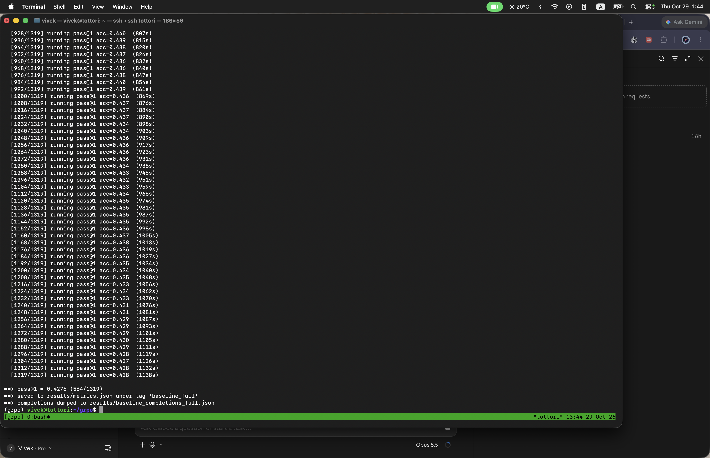

# Run 2026-10-29: GRPO + LoRA on GSM8K (lr 1e-5)

First full end-to-end GRPO-Zero run on a CUDA GPU: full-test-set baseline, 200 GRPO steps, trained-policy eval.

## Headline

| Setting | Model | Metric | n | Correct | Accuracy |
|---|---|---|---|---|---|
| Baseline (untrained) | Qwen2.5-0.5B-Instruct | pass@1 (greedy) | 1319 (full test) | 564 | **0.4276** |
| GRPO-trained (LoRA) | Qwen2.5-0.5B-Instruct + `grpo_lora_lr1e5` | pass@1 (greedy) | 1319 (full test) | 622 | **0.4716** |
| **Delta** | | | | **+58** | **+4.40 pts** (~10% relative) |

Both rows use the same model id, the same 1319 GSM8K test problems, greedy decoding, `max_new_tokens=512`, and the same deterministic verifier ([`src/verifier.py`](../src/verifier.py)). There is no judge model: the reward and the eval are rule-based answer matching.

## Setup

| | |
|---|---|
| Hardware | 1x NVIDIA RTX A6000 (48 GB), Bau lab machine `tottori` |
| Base model | `Qwen/Qwen2.5-0.5B-Instruct`, bf16 |
| Adapter | LoRA r=16, alpha=32, dropout 0.05, all attention + MLP projections |
| Config | [`configs/grpo_gsm8k.yaml`](../configs/grpo_gsm8k.yaml), with **`--lr 1e-5`** (config default is 1e-6) |
| GRPO | 200 steps, 8 prompts/step x group size 8, temp 1.0, KL coef 0.04, clip 0.2, 1 PPO epoch |
| Speed | ~28 s/step (~1.5 h of training) |
| Baseline eval time | ~19 min for 1319 problems (1138 s) |

Commands (from the run checklist, with the lr override and lr-specific paths):

```bash
python -m src.train --config configs/grpo_gsm8k.yaml --resume --lr 1e-5 \
    --save-dir checkpoints/grpo_lora_lr1e5 --log results/train_log_lr1e5.json 2>&1 | tee -a train.log
python -m src.eval --config configs/grpo_gsm8k.yaml --n 1319 --tag trained \
    --adapter checkpoints/grpo_lora_lr1e5 --save-completions results/trained_completions.json 2>&1 | tee trained_eval.log
python -m src.eval --config configs/grpo_gsm8k.yaml --n 1319 --tag baseline_full \
    --save-completions results/baseline_completions_full.json 2>&1 | tee baseline_eval.log
```

## Notes

- The older `baseline` entry in `metrics.json` (0.47, n=100, Apple MPS) is a 100-problem subset from local development and is **not comparable** to the full-test-set numbers above. Compare `baseline_full` vs `trained`.
- `full_test_set` reads `false` in `metrics.json` because the eval was launched with an explicit `--n 1319` rather than `n=null`; 1319 is the entire GSM8K test split.
- With n=1319 the standard error of each accuracy is about 1.4 pts, so a 4.4 pt gain is well outside noise for one run, but it is still a single seed.
- LoRA checkpoints are not committed (see `.gitignore`); they live on the lab machine under `checkpoints/grpo_lora_lr1e5`.

## Screenshots

`metrics.json` as written on the lab machine after both evals:


End of the full-test-set baseline eval (pass@1 = 0.4276, 564/1319):


